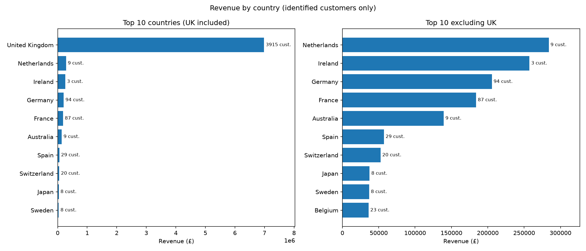
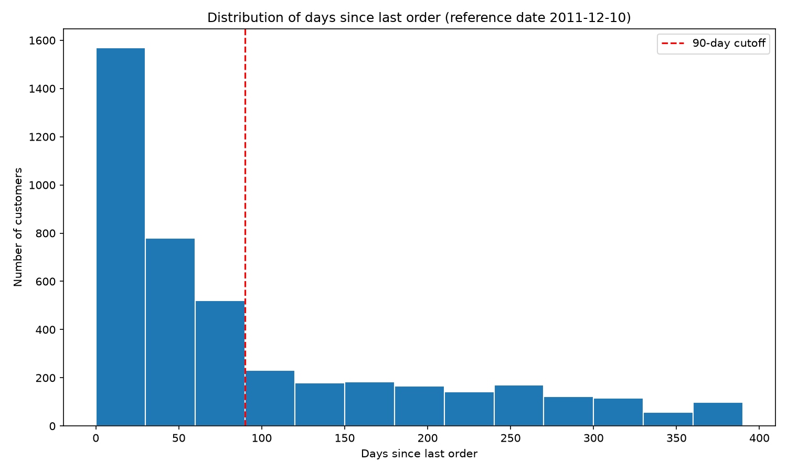

# Customer Retention & Revenue Analysis: Online Retail

**Problem:** a UK online retailer's revenue is inconsistent. Which customers are disengaging, what drives revenue, and what early signs predict a customer is about to stop ordering?

**Result:** 33.8% of customers (1,463 of 4,333) have not ordered in 90+ days, and 61% of them never placed a second order. The revenue at risk sits with 571 lapsed repeat buyers (£568,620 of past spend, spread across many accounts). Details in [`reports/findings.md`](reports/findings.md).

**Run it**
```bash
pip install -r requirements.txt
mkdir -p data/raw   # on Windows: mkdir data\raw
#download "Online Retail.xlsx" (UCI Online Retail dataset) into data/raw/
python src/load_data.py
python src/run_sql_file.py sql/01_create_tables.sql
python src/run_sql_file.py sql/02_clean_data.sql
python src/run_sql_file.py sql/02b_load_tables.sql
```
Then run `notebooks/01_data_loading_and_validation.ipynb` and `notebooks/02_churn_analysis.ipynb` top to bottom.

## Questions answered
- Which customers are disengaging, and how many?
- Which countries and products drive the most revenue?
- Do at-risk customers share traits (buyer type, order value, country, order frequency)?
- Where does the revenue risk sit, and who should be contacted first?

## Approach
1. **Load** the raw Excel file into SQLite, unmodified.
2. **Profile** it in SQL (missing IDs, cancellations, fees, extremes).
3. **Clean** it with one SQL view of six documented rules, then split it into `orders`, `customers` and `products` tables with keys and checks.
4. **Query** revenue per customer, top products, revenue by country and last order date, each reconciled to one total (£8,480,598.41).
5. **Analyse** in Pandas: days since last order, a 90-day churn flag (sensitivity at 60 and 120), one-time vs repeat buyers, traits of at-risk customers, and a tiered win-back list.

## Key findings
- **33.8% at risk** (28% to 46% across cutoffs). 57.2% of one-time buyers are at risk, against 20.6% of repeat buyers.
- **Repeat buyers are 92.3% of revenue** from 64% of customers. The top 10 customers hold 16.45% of revenue, the top 10 products 8.0%.
- **Lapsed repeat buyers** hold £568,620 of past spend. 114 customers reach half of it.
- **The UK is 82% of revenue.** The Netherlands and Ireland each rest on one to two accounts.



## Recommendations
1. Target the second purchase with a follow-up before day 90.
2. Run a tiered win-back: personal contact for 79 high-value lapsed customers, automation for the rest.
3. Flag repeat buyers against their own ordering rhythm instead of a flat 90 days (untested proposal).

## Repository structure
```
data/        raw and processed (not committed)
sql/         numbered SQL files: profile, create, clean, load, queries
src/         load_data.py, run_sql_file.py
notebooks/   01 validation, 02 churn analysis
reports/     findings.md, profiling_notes.md, figures/
```

## Limitations
- Rows without a CustomerID (24.9% of rows, 14.7% of merchandise revenue) are excluded from customer-level results.
- Revenue means merchandise revenue, excluding postage and fees.
- Cancel-and-reissue originals were removed only for the four largest audited cases, so smaller ones may remain.
- The data covers 12 months, so a 90-day rule is crude for slow-cycle buyers, and a customer's own gap is reliable only with 3+ order days.
- Findings show association, not cause. Past spend is not future value.

Full list in [`reports/findings.md`](reports/findings.md). Every cleaning decision is in [`reports/profiling_notes.md`](reports/profiling_notes.md).